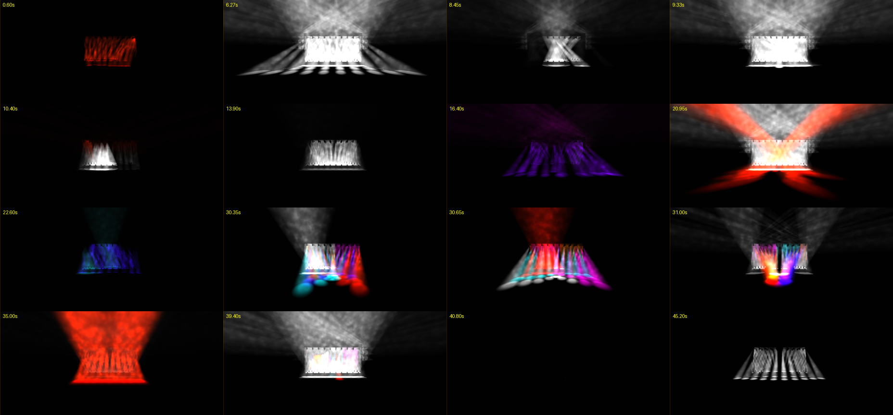

# showtools

**Program timecoded ETC Eos light shows from Python.** Analyse a song and lock a sample-accurate
beat grid to it. Write the show as code that describes what the stage should look like at each
moment. Record hundreds of cues, effects and palettes into Eos over OSC. Then play it from Reaper
and *measure* how close every cue lands to the music.

Built and proven against **Eos 3.3 (offline) + Augment3d + Reaper 7** on Windows, with a
98-fixture rig: 50 × SolaFrame 3000 and 48 × SolaPix 19.

| Example | Song | Cues | What it shows off | Measured timing |
|---|---|---|---|---|
| [`volatile_reaction`](examples/volatile_reaction) | *Volatile Reaction*, Kevin MacLeod (CC BY 4.0) | 164 | First show: beat-tracked cue stack, XYZ beam aiming | ±50 ms jitter (+0.38 s harness offset, fixed later) |
| [`bangarang`](examples/bangarang) | *Bangarang*, Skrillex ft. Sirah | 635 | Exact-BPM grid, continuous beat-locked motion, 98-fixture pixel patterns, laser-style beams | −40 … +75 ms, median +14 ms |
| [`arena`](examples/arena) | *This Is Your Arena* | 102 | **Real Eos effects built from code**: step, absolute and relative effects, palettes, BPM/Rate overrides, fanned delays, full-stage strobe | −46 … +64 ms, median +4 ms |
| [`latency_test`](examples/latency_test) | none (silence) | 31 | Measures your Reaper → MTC → Eos latency | ~117 ms on the reference machine |

> Audio is **not** included (licensing). Every example still ships its analysis, cue sheet and
> show script. Drop in your own copy of the track and it rebuilds exactly.



---

## Why this exists

Programming a busy timecoded show by hand means hundreds of cues, each one nudged until it
"feels" on the beat. This toolkit does it the other way round:

1. **Measure the music.** [`analyze2.py`](docs/tools.md#analyze2py) finds the exact tempo and
   locks the grid to the kick and snare transients, to within ±5 ms. [`slotgrid.py`](docs/tools.md#slotgridpy)
   maps every 16th note. [`onsets.py`](docs/tools.md#onsetspy) handles tracks with no steady beat.
2. **Describe the show as code.** [`rig.py`](docs/rig-api.md) lets a show say *"floor beams fan
   to the sky, odd washes magenta, everything on the beat"*. It turns that into the minimum set
   of Eos command lines and OSC messages, then records the cue. [`fxlib.py`](docs/effects.md)
   builds real Eos step, absolute and relative effects, palettes and BPM overrides by typing into
   the effect editor.
3. **Measure the result.** [`runtest.py`](docs/tools.md#runtestpy) plays the song from Reaper and
   logs Eos's own cue-fire messages against Reaper's audible play position on the same
   high-resolution clock. It reports the timing error of every cue and screenshots Augment3d at
   chosen moments.

## Quick start

```powershell
pip install -r requirements.txt
python eosctl.py ping                       # Eos answering on OSC TCP 3032?
python eosctl.py patch > patch.txt          # your rig: positions feed the geometry
python examples\latency_test\show.py        # 31 test cues in list 5 + events
python runtest.py examples\latency_test --list 5 --dur 17   # -> your system latency
```

Then read **[docs/workflow.md](docs/workflow.md)**, which takes a song to a finished, measured
show step by step.

## Documentation

| Doc | Contents |
|---|---|
| [docs/setup.md](docs/setup.md) | Install, Eos OSC settings, Reaper MTC → loopMIDI → Eos, Augment3d view, `config.py` |
| [docs/workflow.md](docs/workflow.md) | End-to-end: song → analysis → show script → record → load Reaper → measure → iterate |
| [docs/tools.md](docs/tools.md) | Reference for every script (CLI + Python API) |
| [docs/rig-api.md](docs/rig-api.md) | `rig.Show`: state model, setters, diffing, recording, events, groups and geometry |
| [docs/effects.md](docs/effects.md) | Building Eos effects and palettes from code (`fxlib.py`), plus the effect library from the Arena show |
| [docs/eos-osc-cookbook.md](docs/eos-osc-cookbook.md) | Every Eos command-line and OSC syntax verified while building these shows, including the gotchas |
| [docs/timing.md](docs/timing.md) | Grid locking, latency, MTC frame quantisation, how `runtest.py` measures |
| [docs/augment3d.md](docs/augment3d.md) | What renders and what doesn't in Augment3d, beam settings that look right, camera |
| [docs/troubleshooting.md](docs/troubleshooting.md) | Symptoms → causes → fixes, all hit for real |
| [examples/README.md](examples/README.md) | The four example shows |

## Layout

```
showtools/
├── config.py          machine-specific settings (env-var overridable)
├── eosctl.py          OSC/TCP client for Eos + CLI (ping, cmd, get, patch, list, watch)
├── eostry.py          try command lines, print the console's echo
├── eosui.py           drive softkeys by label + hard keys (for UI-only Eos features)
├── rig.py             state-based cue writer + rig geometry/groups (reads patch.txt)
├── fxlib.py           build Eos effects/palettes from code + geometry chase helpers
├── analyze2.py        exact-BPM grid locked to transients, per-band transients, bar energy
├── slotgrid.py        per-16th feature map + drum-tracker printout
├── onsets.py          event list for non-grid (cinematic) tracks
├── analyze.py         first-generation analyser (used by volatile_reaction)
├── runtest.py         play from Reaper, measure every cue fire, screenshot Augment3d
├── render_video.py    render the show to an MP4 with the song (clock-synced capture of Augment3d)
├── reaper_load.py     safe front-end for the Reaper Lua scripts
├── a3d_place.py       place fixtures in Augment3d from a patch dump (Patch command line)
├── a3d_inspector.py   type into the Augment3d Edit Mode Inspector (objects: deck, truss)
├── deskctl.py         screenshots, window focus, mouse/keyboard (DPI-aware)
├── look.py            screenshot the Augment3d area
├── patch.txt          `eosctl.py patch` dump of the rig (positions, types)
├── reaper/            ReaScripts: load song+markers, open project, extend timecode, play/stop/sync
├── dev/               look development + probing utilities
├── examples/          the four shows
└── docs/
```

## Requirements

- Windows 10/11 (desktop control and Reaper launching are Windows-specific; the OSC and analysis code is not)
- Python 3.11+ (developed on 3.13)
- ETC Eos family software 3.x with OSC over TCP enabled (offline or on a console)
- Reaper 7, plus a virtual MIDI port such as loopMIDI if Reaper and Eos are on the same PC
- `ffmpeg` on PATH to convert MP3 to WAV

## Licence

MIT. See [LICENSE](LICENSE). Song credits and licences are listed in each example's README.
