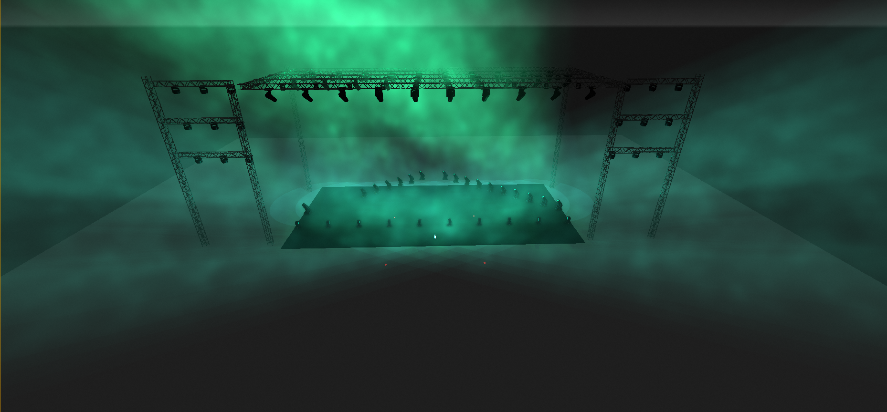

# Stage: building the Augment3d model from scratch

This builds a simple stage around the existing 98 fixtures in an empty Augment3d model. It
places no cues and does no programming.



| Element | Size / position |
|---|---|
| Deck | `Staging2x1m` resized to 20 × 10 × 1 m, front-left-bottom corner at (−10, −1, 0) |
| Overhead grid | 5 × `Truss Square` runs, 21 m long, 0.3 m section, at y = 0, 2, 4, 6, 8, underside at 9.95 m |
| Grid rails | 2 runs, 8.6 m long, at x = ±10.5 tying the grid together |
| Grid legs | 4 vertical runs at the grid corners |
| Side towers | each with an outer leg and three 4.2 m bars at 6, 8 and 10 m carrying the 3 × 3 SolaPix towers |
| Fixtures | positions and orientations restored from `patch.txt` (the same layout the example shows use) |

## How it's done

1. **Fixtures** use the Eos command line, entered in Patch (`../../a3d_place.py`):
   ```powershell
   python a3d_place.py patch.txt --only 101-150,201-248
   ```
   This types `Chan 101 Position - 9 / 0 / 9.85` and `Chan 131 Orientation 0 / 180 / 0`. The
   spaces around `/` are required.
2. **Objects** go through Augment3d Edit Mode with UI automation (`build_stage.py` and
   `../../a3d_inspector.py`). The script drags *Truss Square* from Library → Stock → Truss into
   the viewport. The new object becomes the selection, and the script then types its Name,
   Size, Rotation and Position into the Inspector.
   ```powershell
   python examples\stage\build_stage.py --dry      # list of truss pieces
   python examples\stage\build_stage.py            # build them (Edit Mode open, see preconditions)
   ```
   The deck was added the same way (Staging2x1m, then Size 20/10/1, then Position −10/−1/0).

Findings:
- **Truss Square** is 0.8 × 0.25 × 0.25 m by default. Its pivot is at its start (min x), and its
  length runs along local +X.
- **Rotations:** Z 90° turns a truss upstage (+Y), and Y −90° stands it up vertically.
- **Staging2x1m** has its pivot at the front-left **bottom** corner.
- **Truss Inspector rows:** truss objects have no *Scale* row, so their Size and World rows sit
  higher (`--layout truss`).
- **Leaving Edit Mode can close the Augment3d tab.** Reopen it with the tab bar's **+**, then
  *Augment3d [Tab 38]*.
- **Saving:** the model change shows as `(Augment3d*)` in the title bar. It's saved with the
  show file (**File → Save**).
