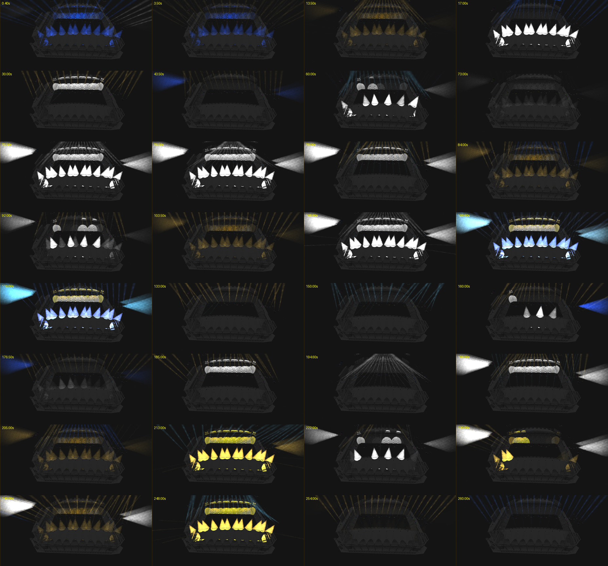

# Union: a Philadelphia Union show at Subaru Park

- **Venue:** Subaru Park, a Mini Skyline GLB (OpenStreetMap / Overture data; see the model's attribution files) imported into Augment3d at **Scale 10.4**, Rotation (−90, 0, 80), Position (69.9, −13.7, −2.94). That makes the pitch a true 104 × 64 m, centred on the world origin with its long axis on X.
- **Audio:** a mashup of *Party Till We Die* (MAKJ & Timmy Trumpet ft. Andrew W.K.) and the Philadelphia Union "Doop" song. 128.000 BPM, 4:26. Not included.
- **Eos:** cue list 7, event list 7 (MIDI timecode). **314 cues**, plus palettes CP 71–76, FP 71–78 / 81–84 and effects 880–895.
- **Measured:** all 313 timed cues fired, −45 … +63 ms, median +5 ms.



## Rig (`rig_union.py` computes every position from the stadium mesh)

| Channels | Fixture | Where |
|---|---|---|
| 301–340 | 40 × Elation **Proteus Excalibur** (IP65 beam) | upright on top of the roof leading edge, 20 per long side; render beam angle 5° |
| 401–424 | 24 × GLP **JDC2 IP** (M1) | hung under the roof edge between the beams |
| 425–432 | 8 × JDC2 IP | west scoreboard tower face / east stand top |
| 501–532 | 32 × Elation **Proteus Hybrid Max** (Standard) | ring around the pitch at ground level; render beam angle 5° |

Why these:
- **Outdoor-rated:** all three are IP65.
- **Excaliburs:** long-throw beams, mounted upright so they can reach the sky. Hung under the roof, the tilt range clamps them below about 45°.
- **JDC2s:** strobes and blinders on the roof edge.
- **Hybrid Max ring:** builds a beam "tent" over the pitch. The Proteus Rayzor 760 was tried first, but its wide wash barely renders in Augment3d.

## Library (`build_fx.py`)

| | |
|---|---|
| Colour | 71 Union Navy · 72 Union Gold · 73 Union Light Blue · 74 White · 75 Deep Blue · 76 Warm Gold |
| Excalibur focus | 71 Sky Fan · 72 Sky Cross · 73 Centre Spot · 74 Crown · 75/76 Sweep W/E · 77 Pillars · 78 Pitch Lines |
| Ring focus | 81 Ring Up · 82 Tent · 83 Ring Out · 84 Into Stands |
| Step effects | 880 **RATTLESNAKE** (comet chase round the ring, after the snake on the crest) · 881 SIDE SLAM N-S · 882 ROOF WIPE W-E · 883 JDC STROBE · 884 SPARKLE · 885 ENDS PING · 886 **13 STARS** (13 random fixtures, after the crest's stars) |
| Absolute | 890 NAVY-GOLD · 891 SKY SNAP (fan ↔ cross) · 892 SKY SWEEP |
| Relative | 895 SKY CIRCLE |

## Show

| Time | Section | Look |
|---|---|---|
| 0:00.2 | Impact | Whole stadium white, then navy pillars rise W→E (fanned delay) |
| 0:01–0:12 | Intro chords | Gold/navy halves swap every bar, sky fan ↔ cross |
| 0:12.6 | Tone | Golden crown: all 40 beams meet above the centre spot, then sparkle |
| 0:16–0:42 | Groove A | Rattlesnake on the ring, sky snaps on the downbeat, JDC hits alternating N/S on 2 & 4 |
| 0:46–1:16 | Riser | Sky sweep accelerating (Rate 100→400), sparkle, whitening, 8th→16th roll, suck-out |
| **1:16** | **Drop 1** | White blinder, then 4-bar blocks: side slam · snake + navy/gold · 13 stars · end pings, with a cue on every beat |
| 1:42 | Tone 2 | Golden crown |
| **1:48.6–1:48.8** | **DOOP** | Hard silence, then full-stadium hit, then the Union split: gold north / navy south, sky circles |
| 2:10–3:14 | Grooves, breaks, build 2 | Light blue / gold, 13 stars |
| **3:14** | **Final drop** | 31 bars, five rotating techniques plus end strobes every 4 bars |
| 4:12 | Outro | Gold pillars fade to navy, then black |

## Rebuild

```powershell
python examples\union\rig_union.py          # place fixtures (types must already be patched)
python examples\union\build_fx.py           # palettes + effects
python examples\union\show.py               # cue list 7 + event list 7
python reaper_load.py split-timecode --seconds 280   # MTC past 3:00 (see below)
```

**MTC past 3:00:** the Reaper SMPTE generator item stops generating after its original source
length (~3:00), even when the item is lengthened. `reaper/split_timecode.lua` adds a second
generator item from 2:50 whose timecode starts at 2:50. Eos chases straight across the join.
